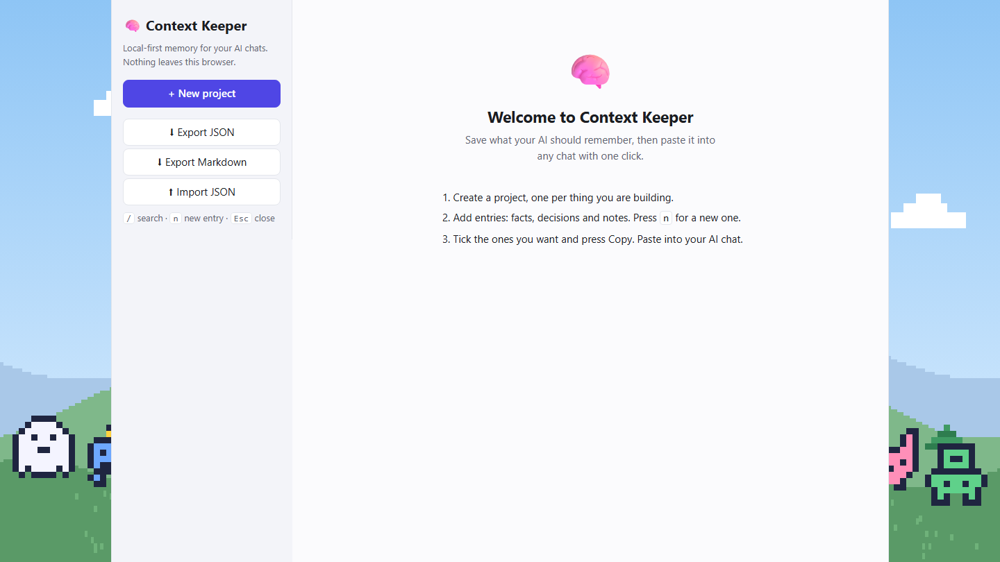

# Squirrow

A local-first memory manager for your AI chats. Save facts, decisions, preferences, snippets and file notes per project, then copy the ones you pick into ChatGPT, Claude or any other assistant. No account, no backend. Your data stays in your browser's IndexedDB.



Live at https://squirrow.thymeed.workers.dev. It is installable and works offline.

## Install it as an app

- **Chrome or Edge (desktop):** open the site and click the install icon at the right of the address bar.
- **Android (Chrome):** open the menu and choose **Install app**.
- **iPhone or iPad (Safari):** tap **Share**, then **Add to Home Screen**.

After the first visit, the app opens without a connection.

## Back up your data

Your entries live only in this browser on this device. Clearing site data, using a private window, or switching browsers or devices means you won't see them. Use **Export JSON** now and then to keep a backup, and **Import JSON** to restore it or move it to another device.

## What it does

- **Projects** with five kinds of entry: fact, decision, preference, snippet and file note. Each kind has its own color and icon, and the entry dialog explains the chosen kind with an example.
- **Search** matches the start of any word, so `setup` finds "Database setup" but `base` does not. Every search word must match, and title matches rank above body matches. Ties go to the most recently edited entry.
- **Copy for your AI chat:** tick entries, see a token estimate, and copy a paste-ready Markdown block. Snippets are wrapped in code fences.
- **Keyboard first:** `/` to search, `n` for a new entry, `Esc` to close.
- **Export and import:** JSON round-trips, and Markdown export is available. Import asks before it replaces your data.
- **Beginner friendly:** an empty-state guide with three steps, and a clear "Title is required" message instead of a silent failure.
- **Pixel-art scenery** (light and dark) with twinkling stars, shooting stars and hopping robots. The motion switches off when your system asks for reduced motion.

## Develop

```
npm install
npm run dev      # local server
npm test         # Vitest (core logic, UI flows, service worker)
npm run build    # typecheck + production build into dist/
npm run format   # Prettier; CI runs format:check
```

The scenery images are generated: edit `scripts/make-scenery.py` and run `python scripts/make-scenery.py` from the repo root.

## How it is built

React 19, TypeScript and Vite. Logic lives in `src/core` with no React imports: storage behind a `Repository` interface, ranking in `search.ts`, context building and the token estimate in `inject.ts`, and import parsing in `portability.ts`. Untrusted input is parsed in one place, `parseSnapshot`. See [ARCHITECTURE.md](ARCHITECTURE.md) for the design decisions.

## Limits

- The token count is an estimate of about 4 characters per token, not a real tokenizer.
- The list is not virtualized, which is fine for hundreds of entries. It would need changing for thousands.
- Tests cover `src/core`, the main UI flows and the service worker. Browser-specific behavior such as installing and clipboard permissions is checked by hand.

## Privacy

Nothing is sent anywhere. There is no backend, analytics or account.

## License

MIT
